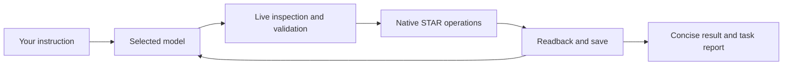

<div align="center">

# GoStar

**Talk to your STAR-CCM+ simulation.**

Natural-language configuration, native API inspection, and verified changes—inside STAR-CCM+.


[简体中文](README.zh-CN.md) · [Install](docs/INSTALL.md) · [Aerodynamic reports](docs/REPORTS.md) · [Validation](docs/VALIDATION_061.md)

</div>

## What it does

- Inspect the **selected SIM**, its geometry, mesh settings, physics and reports.
- Create or modify domains, boundaries, mesh controls, physics, reports, monitors and scenes through checked native operations.
- Discover installed Java API signatures and use guarded property setters for additional configuration.
- Show concise change summaries; keep raw diagnostics, readbacks and recovery files in task reports.

Your selected model plans the work. GoStar validates the proposal, applies it to the selected SIM, reads back the result and saves evidence. It does not silently switch model providers.



## Quick start

1. Extract `GoStar-0.6.1.zip` from `dist/` (or a published release).
2. In STAR, open **Tools → Plugins → Downloaded → Add Plugins** and select `plugin/GoStar-0.6.1.nbm`. Complete installation and restart STAR. The locally built plugin is unsigned.
3. Open a SIM, then **Tools → GoStar**, and select the intended simulation.
4. In **Settings**, configure your provider, endpoint, model ID and API key. For optional local help retrieval, select the extracted `runtime/` under **Simulation ⋯ → Library directory** and install Python 3.10+.
5. Describe the change. Automatic execution applies supported authorized edits after validation; review mode shows the proposal first.

API keys are entered on your computer and are not included in this project. An OpenAI-compatible endpoint must accept the plugin's chat message protocol. Provider compatibility is not guaranteed for every endpoint; API errors are reported without switching routes.

## Example requests

> Inspect the current mesh controls and explain the settings. Do not change anything.

> Create a drag coefficient report on the Wing wall, direction [1, 0, 0] in Lab. Use density 1.18 kg/m³, speed 210 m/s and reference area 2.5 m². Include pressure and shear, disable idealization, and create a monitor and history plot. Do not run CFD.

> Change only that report's reference area to 3.25 m². Preserve the other settings.

These numbers illustrate explicit inputs; they are **not universal aerodynamic defaults**. GoStar asks for missing reference area or moment origin instead of assuming arbitrary values. [Report conventions and supported parameters →](docs/REPORTS.md)

## Build and test

Requires a licensed installation of **STAR-CCM+ 2406.0001 / 19.04.009-R8** and its Java 21 JDK. Linux is tested; Windows and other STAR versions need independent validation.

```bash
python3 plugin/build_plugin.py --star-home /path/to/STAR-CCM+19.04.009-R8 --jdk /path/to/jdk21
python3 packaging/build_distributions.py
python3 -m unittest discover -s tests -p 'test_gostar_release.py'
```

Licensed native tests and loopback provider tests are documented in [Validation](docs/VALIDATION_061.md). Native tests use temporary profiles and synthetic simulations; they do not open your production SIM.

## Scope and ownership

A configured report is not a converged result. Meshing, finite-step solving and physical convergence are separate outcomes. The guarded API bridge is not unrestricted Java execution, and not every STAR API is supported.

This repository contains project-owned source and guidance. It excludes Siemens binaries and copied commercial help, user CAD/SIM files, private conversations and credentials. Optional help search reads documentation already installed on the user's machine. STAR-CCM+ is a Siemens product; GoStar is an independent project. Public availability does not itself grant an open-source license.
